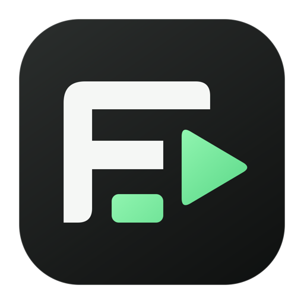

# SceneForge



A local desktop video editor for **macOS 14 or later on Apple Silicon**. Write scene scripts, record screen and camera, edit a multi-track timeline, edit with Claude Code in the app, or connect an AI assistant through the built-in MCP server.

SceneForge is an early, independently authored open-source project. It is not affiliated with Borumi and does not include Borumi source code, proprietary assets, hosted services, or private project media. Some familiar workflows are implemented; complete feature or pixel parity is not claimed. See [known limitations](docs/LIMITATIONS.md) and [validation status](docs/VALIDATION.md).

## Install

Download **[SceneForge-macOS-arm64.dmg](https://github.com/Samin12/SceneForge/releases/download/v0.1.0-preview.1/SceneForge-macOS-arm64.dmg)** from the [release page](https://github.com/Samin12/SceneForge/releases/tag/v0.1.0-preview.1). Open it, drag **SceneForge** into **Applications**, eject the disk image, then open the app from Applications. A [ZIP download](https://github.com/Samin12/SceneForge/releases/download/v0.1.0-preview.1/SceneForge-macOS-arm64.zip) is also available if you prefer to move the app yourself.

This prerelease is **Apple Development signed with a stable identity, but not Apple-notarized**. macOS may block its first launch. Review the release and its checksums before deciding whether to open it; Apple documents the [Open Anyway procedure](https://support.apple.com/guide/mac-help/open-a-mac-app-from-an-unknown-developer-mh40616/mac). No paid account is required for local editing.

The desktop download includes FFmpeg/FFprobe, Whisper, the English `base.en` speech model, and precompiled text/Vision helpers. Local editing, export and English transcription do not require Homebrew or separate media-tool installation. The packaged runtime passed an isolated-profile test with Homebrew excluded from `PATH`, including transcription, composed-frame inspection and an audiovisual export. Source builds need the documented tools or a built runtime. See [installation and building](docs/INSTALL.md).

## Watch a sample

[Watch or download the 12-second SceneForge sample](https://github.com/Samin12/SceneForge/releases/download/v0.1.0-preview.1/SceneForge-demo.mp4). It was assembled through the installed MCP server and rendered in SceneForge, using original synthetic visuals, local narration, timed graphics and captions. [How the sample was made](docs/DEMO.md).

## Make a video

1. **Script:** create a project and write scene scripts. Use the teleprompter for manual, constant-speed, or local speech-following presentation.
2. **Record:** choose a display, window, or region alongside your camera and microphone. Check the live previews, then start with a cancellable three-chime countdown. Desktop recording includes movable camera/script controls and a green capture border. After Stop, review the saved sources and waveforms. Keep and revisit takes on scene cards. **Confirm** applies the chosen take and stays in the same scene; choose another scene when ready. Replace matching sources, keep takes sequentially, or use Record over to overlap them. The menu also offers **Confirm & edit**. [Recording guide](docs/RECORDING.md).
3. **Edit:** import footage, trim or split clips, arrange the canvas, and add titles and captions. Automatic transcription is **on by default and runs locally**. Select transcript words and press Delete to remove that interval across the timeline, with Undo available. Drag empty timeline space to select clips across tracks; Shift-drag the ruler to select a time range.
4. **Review quick actions:** **Auto-cut** proposes quiet-gap and repeated-take cuts. **Visualize** proposes layouts, chapter titles and labels using existing sources. Review the reasons, compare rendered frames and apply the changes you select. Both run locally by default and plan for the entire project. Optional Claude narrative analysis is off by default; it shares transcript context and uses your Claude account. [Editing guide](docs/EDITING.md).
5. **Export:** render MP4 or WebM, or export WAV, SRT, text, Markdown, or project JSON. Choose the full timeline, a scene, or a time range. **Export → Borumi project…** can write a separate native project copy for a limited set of supported edits. Review its blockers before exporting. Projects with recording-take history are blocked to avoid losing archived takes. [Compatibility guide](docs/BORUMI-COMPATIBILITY.md).

Projects autosave locally. Undo/redo, saved history, and conflict detection help protect edits. Source media is referenced without overwriting the originals; uploaded files and recordings are stored inside SceneForge's data folder. Keep that media available when reopening a project. Saved takes are retained in the project, including archived attempts, while recordings remain local files. Copying project JSON alone does not move footage.

**Trash** restoration, **Locate media** with guarded Undo, and durable export history help recover work. Face centering follows the largest locally detected face at up to four samples per second, with interpolated crop motion in preview and export. **Restart saved export** renders a frozen project version and settings from the beginning without replacing current edits. [Recovery guide](docs/RECOVERY.md).

A complete 20-minute complex-project export passed full decode and independent whole-audio checks. Sampled layout, cursor-position and corrected camera-crop checks passed; exact Borumi visuals are not identical. Camera, microphone and screen grants survived an installed A→B→A update test on one Mac without new consent prompts. Complete four-source/region recording acceptance for the final package remains open. [Validation and boundaries](docs/VALIDATION.md).

Keyboard defaults include **A** select, **B** blade, **⌘B** split at the playhead, **S** scrubbing, **N** snapping, **Q/W** trim to the playhead, and **Space** play/pause. Bindings are configurable in Settings. See [keyboard behavior](docs/SHORTCUTS.md).

## Edit with Claude

Open a project in **Edit**, then choose **Ask Claude**. The panel uses your separately installed **Claude Code 2.1.248 or later** and its existing sign-in. If needed, run `claude auth login` in Terminal, then click **Refresh** in the panel. SceneForge does not require you to copy Claude credentials or an API key into the app.

Select clips, optionally set a time range, and check the context shown above the message box. For example: “Set the gain of these two clips to 50%, keeping their timing unchanged.” **Send** freezes that context, and committed changes appear in the timeline. With no clip selection or range, the context explicitly reads **Entire project**. **Undo this edit** restores the preceding project only if no later edit conflicts.

Claude chat can inspect and edit the scoped project; import, export and cloud transcription are not exposed to this chat. Use the app's Export control or the broader MCP connection below for those workflows. Claude provider costs and data handling apply. Selection is an edit boundary, not strict visual isolation: inspected frames can include overlapping layers, and the request includes recent conversation context from the same project. [Setup and editing guide](docs/CLAUDE-CHAT.md) · [Privacy](docs/PRIVACY.md)

## AI control with MCP

SceneForge exposes **39 local MCP tools** for reading projects, seeing composed frames, staging edits, committing changes, transcription, export, and reviewed recovery of media references, deleted projects and saved exports. The packaged server passed actual tool discovery and edit/inspect/export checks. Check your server's `tools/list` when connecting an older build. This is an independent MCP contract; it does not connect to or impersonate Borumi's server.

Add this stdio server to an MCP-compatible assistant. If you installed the application elsewhere, replace the command with its actual path. Settings → **AI control · MCP** provides a copyable configuration.

```json
{
  "mcpServers": {
    "sceneforge": {
      "command": "/Applications/SceneForge.app/Contents/MacOS/sceneforge-mcp",
      "args": []
    }
  }
}
```

The launcher starts or reuses SceneForge's local editing service. A useful request is: “Duplicate this project, trim its opening, add a title, show me the edited frame, then export an MP4.” The assistant can inspect → begin an edit → stage changes → review the staged project → commit → inspect actual frames → export. Frame inspection renders **committed** state, so visual review follows the commit. Edits appear in an open clean editor automatically; unsaved local edits are preserved behind a conflict notice.

An assistant with this connection can read project content and local media, edit projects, and run exports. Connect only assistants you trust. Content returned to a cloud-hosted assistant may leave your Mac according to that assistant's settings. [MCP guide](docs/MCP.md) · [Privacy and local data](docs/PRIVACY.md)

## Develop

Use Node.js 24, npm, and Apple's command-line developer tools. FFmpeg/FFprobe must be available for media operations; local transcription additionally needs `whisper-cli` and a Whisper GGML model.

```sh
cd app
npm ci
npm run dev
```

Open `http://127.0.0.1:4173`. The local API uses port `4174`.

```sh
npm test
npm run build:all
npm run desktop
```

[Build and package instructions](docs/INSTALL.md) include the pinned native runtime recipe and [stable local signing](docs/SIGNING.md). GitHub CI runs the source tests and production build on macOS with Node.js 24. See [validation](docs/VALIDATION.md) for completed checks and remaining hardware limits. Tests use synthetic fixtures and do not establish exact compatibility with every imported project or physical recording device.

## License

The independent SceneForge implementation is [MIT licensed](LICENSE). Dependencies retain their own licenses. FFmpeg built with x264 is GPL-2.0-or-later and runs as a separate command-line program. The release includes its notices and provides the matching **[SceneForge-runtime-sources.zip](https://github.com/Samin12/SceneForge/releases/download/v0.1.0-preview.1/SceneForge-runtime-sources.zip)** beside the application download. See [third-party notices](THIRD_PARTY_NOTICES.md).
